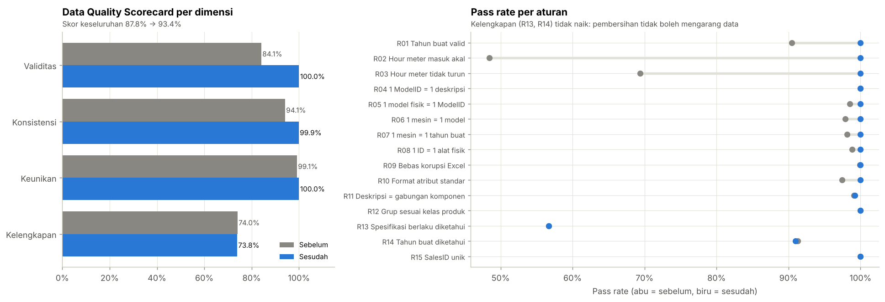
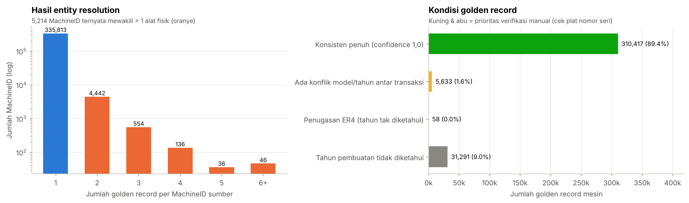
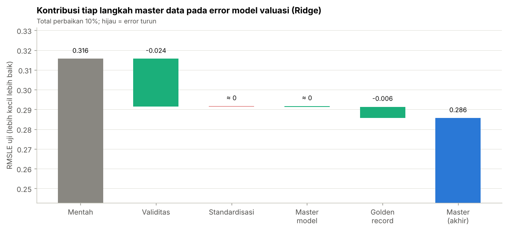
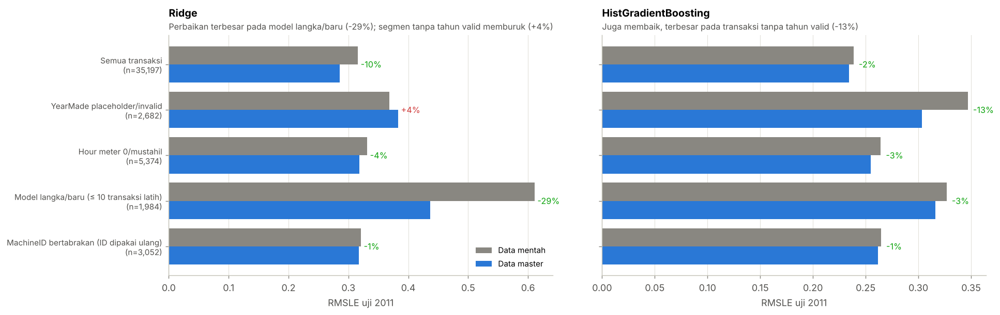

# Heavy Equipment Master Data: Standardization, Entity Resolution & Golden Record

> **Master Data Alat Berat** — profiling kualitas data, aturan kualitas data, standardisasi, deduplikasi,
> *entity resolution*, dan **golden record per mesin** untuk 412 ribu transaksi alat berat, disimpan ke database SQL
> dengan skema master–transaksi, lalu dibuktikan dampaknya pada **model harga (valuasi)**. Metodologi CRISP-DM.

   

## Ringkasan hasil

| Area | Sebelum | Sesudah |
|---|---|---|
| **Data Quality Score** (15 aturan, 4 dimensi) | 87,8% | **93,4%** |
| Validitas · Konsistensi · Keunikan | 84,1% · 94,1% · 99,1% | **100% · 99,9% · 100%** |
| Identitas mesin | 341.027 `MachineID` (5.214 dipakai ulang untuk > 1 alat) | **347.399 golden record** + crosswalk |
| Master model | 5.218 `ModelID` | **5.140 model kanonik** (78 duplikat digabung) |
| Umur rata-rata unit (KPI armada) | 106,7 tahun (placeholder `YearMade = 1000`) | **10,3 tahun** |
| Error model valuasi linear (RMSLE, uji 2011) | 0,316 | **0,286 (−9,5%, signifikan)** |
| Error model gradient boosting (RMSLE) | 0,2385 | **0,2340 (−1,9%, 9× noise)** |
| Error pada model langka/baru (linear) | 0,611 | **0,436 (−29%)** |



## Masalah yang ditemukan & cara menanganinya

| Masalah | Contoh | Penanganan |
|---|---|---|
| ID mesin dipakai ulang | 1 `MachineID` = 13 unit loader & excavator | *Entity resolution*: grup produk + base model + klaster tahun ±1 |
| Placeholder & nilai mustahil | `YearMade = 1000` (9,5%), hour meter 0 atau 2,48 juta jam | Aturan validitas → dikarantina dengan *flag*, nilai asli disimpan |
| Hour meter turun | 30% pasangan transaksi berurutan | Bacaan yang turun dikarantina (`hours_flag = decreasing`) |
| Korupsi Excel | `214E4` → `2.14E+06`, `-IV` → `#NAME?` | Rekonstruksi dari komponen deskripsi |
| Duplikat master model | `125B` wheel loader punya 2 `ModelID` | Kunci pencocokan deskripsi ternormalisasi + kelas produk |
| Format & satuan tidak seragam | `17.5` / `17.5"`, `9' 6"`, `EROPS AC` | Domain baku + kolom numerik (inci/kaki) |
| "Kosong" yang berbeda makna | `None or Unspecified` vs atribut tidak relevan | `Unknown` (berlaku, tidak diketahui) vs `N/A` (tidak berlaku) |



## Dampak pada model harga

Eksperimen tanpa kebocoran waktu: latih ≤ 2010, uji 2011; master & golden record **dibangun hanya dari data latih**.
Transformasi fitur identik — yang berbeda hanya kualitas datanya.




**Temuan jujur:** kelengkapan atribut spesifikasi **tidak** dapat dinaikkan oleh pembersihan (nilai yang tidak diketahui
tidak pernah diketahui di transaksi lain mesin yang sama) — hanya bisa diperbaiki di proses input. Pada transaksi tanpa
tahun valid, model linear sedikit memburuk (+4%) karena unit tanpa tahun cenderung lebih tua dari median modelnya
(data hilang tidak acak).

## Skema database (SQLite)

```
dim_model 1 ── * xref_model          (ModelID sumber → model kanonik)
    1
    └── * dim_machine 1 ── * xref_machine      (MachineID sumber → golden record)
                      1 ── * machine_attribute (spesifikasi golden, format panjang)
                      1 ── * fact_sale         (425 ribu transaksi; harga NULL untuk batch 2012)
dq_rule_result, dq_scorecard                   (hasil aturan sebelum/sesudah → sumber dashboard)
```
Integritas diverifikasi dengan SQL: 0 pelanggaran foreign key, 0 transaksi tanpa golden record, 0 hour meter turun.

## Isi notebook (CRISP-DM)

1. **Business Understanding** — konteks armada kontraktor tambang, tujuan, 6 kriteria sukses.
2. **Data Understanding** — matriks *applicability*, profiling 4 dimensi per kolom, anomali, korupsi Excel, tabrakan ID.
3. **Data Preparation** — katalog 15 aturan kualitas data (*rule engine*), scorecard per sumber data, standardisasi,
   master model, *entity resolution* & *survivorship*, scorecard sebelum/sesudah, integrasi batch 2012, SQLite.
4. **Modeling** — Ridge & HistGradientBoosting, data mentah vs master *as-of*, ablation kumulatif.
5. **Evaluation** — paired bootstrap CI, error per segmen, distorsi KPI armada, kriteria sukses, rekomendasi tata kelola data.

## Cara menjalankan

```bash
pip install -r requirements.txt
# unduh Train.csv, Valid.csv, Test.csv dari Kaggle ke folder data/ (lihat data/README.md)
jupyter notebook heavy_equipment_master_data.ipynb   # Run All, ± 9–12 menit
```
Output: `outputs/heavy_equipment_master.db` dan `outputs/dq_*.csv` (siap untuk dashboard Power BI).

## Struktur repo

```
├── heavy_equipment_master_data.ipynb   # notebook utama (CRISP-DM tahap 1–5)
├── data/README.md                      # petunjuk unduh dataset
├── outputs/                            # database & CSV hasil (dibangun notebook)
├── images/                             # gambar untuk README
└── requirements.txt
```

## Tahap berikutnya
Dashboard Power BI **Data Quality Scorecard** (sebelum vs sesudah, per aturan, per sumber data) dari tabel
`dq_rule_result`, `dq_scorecard`, dan `outputs/*.csv`.

## Dataset
*Blue Book for Bulldozers* — Kaggle (Fast Iron). Data lelang alat berat di Amerika Serikat dipakai sebagai proksi
data aset armada multi-sumber.
